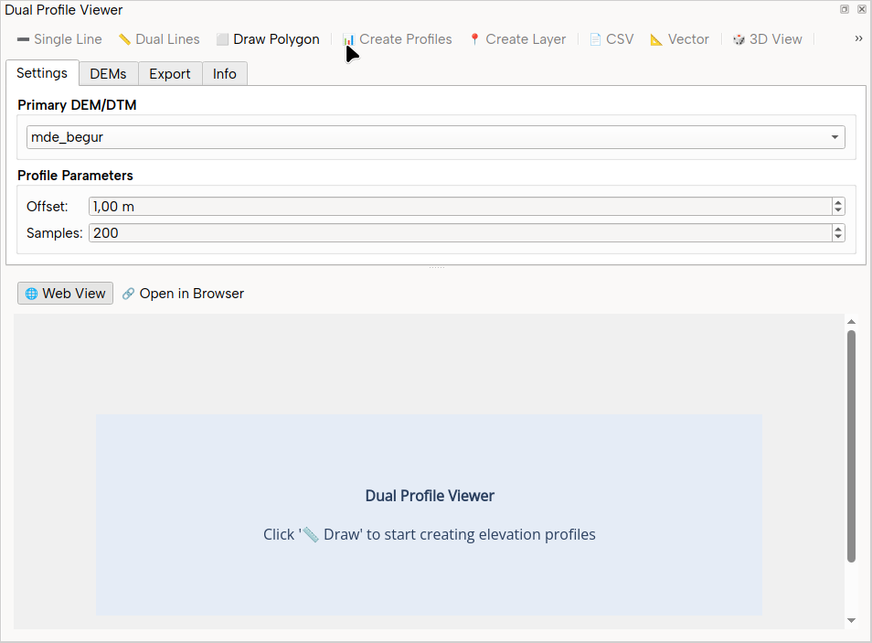
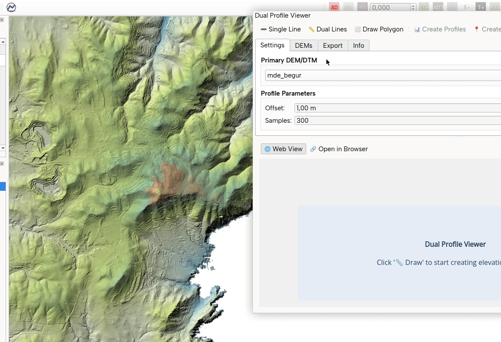
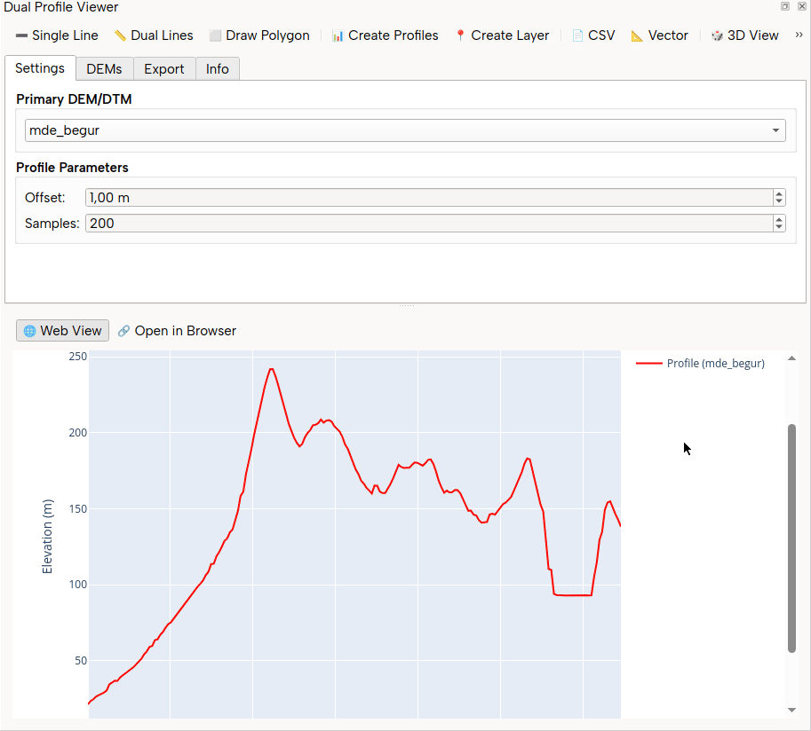

# La creació de perfils topogràfics amb QGIS

A l'hora de dissenyar un perfil topogràfic amb QGIS, per posteriorment incorporar-lo a un *layout* o disseny de mapa, disposem de diverses opcions:

* Dissenyar un perfil topogràfic a la finestra de mapa de QGIS
* Dissenyar el perfil topogràfic, directament des de la finestra de *layout*. 

## Utilitzar complements o *plugins* de QGIS

Són diversos els complements (ArcGeek Calculator, Dual Profile Viewer, Terrain profile, ...) que, una vegada instal·lats a QGIS, permeten la creació i exportació un perfil topogràfic, en format d'imatge. La utilització d'un o altre complement dependrà en bona mesura del tipus de perfil que es vulgui generar.

Per a l'obtenció d'un perfil rectilíni, QGIS disposa de diverses opcions que són realment útils com, per exemple **Dual Profile Viewer** i **Open Topoprofile Studio**.

### Dual profile Viewer

Una vegada instal·lat el complement, s'hi pot accedir bé a través del menú *Raster > Dual Profile Viewer* o bé, a través de la icona visible a la zona de barres d'eines.

En accedir a l'eina, es mostra un panell amb diverses opcions que caldrà configurar segons la necessitat. A continuació, es mostra un flux de treball bàsic per obtenir un perfil.

*  A l'apartat *Settings*, cal indicar el model digital d'elevacions que prèviament s'haurà carregat al panell de capes de QGIS: **Primary DEM/DTM**
*  A *Samples* cal indicar el nombre de mostres o punts que se situaran al llarg de la línia de perfil, d'on s'obtindrà el valor de cota.
*  Fer un clic sobre l'apartat o botó *Single Line* i dibuixar sobre la finestra de mapa, el punt inicial o final de la línia que es vol utilitzar per calcular el perfil. Una vegada incorporada la línia de perfil, el complement indica que havent finalitzat aquesta tasca, cal fer un clic sobre el botó *Create Profiles*.

* En fer un clic sobre el botó *Create Profiles*, automàticament es mostrarà el perfil topogràfic, podent alternar entre la visualització en mode **web**, o bé en mode **gràfic**. Aquest darrer (desactivant el mode web) permet ajustar-ne alguns paràmetres relatius a les dimensions:

* Així com el textos, color i gruix del perfil topogràfic. Havent realitzat tots els ajustos necessaris, es pot exportar el perfil topogràfic en format imatge (p.e. **.png**) o en format vectorial (**.svg**).

* 

El complement Dual Profile Viewer, a més, disposa d'una opció interessant i és que permet construir un layout bàsic, tot incorporant les capes visibles al panell de capes així com el perfil que s'acaba de calcular. Per a executar aquesta opció, cal fer un clic sobre l'opció *Generate layout*, i automàticament es crearà un nou *layout*, accessible des del gestor de *layouts* i des del menú *Project*. Aquest layout bàsic, es pot editar a continuació, per ajustar-los als criteris de disseny necessaris. 

* 
