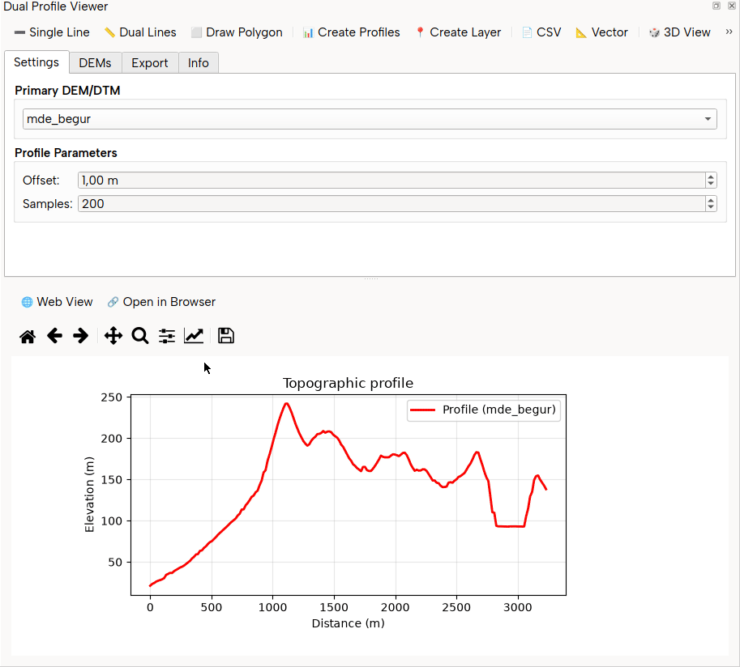
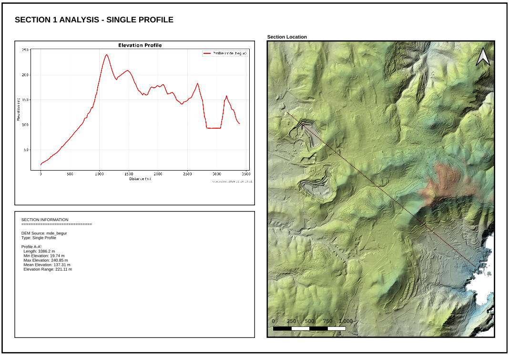
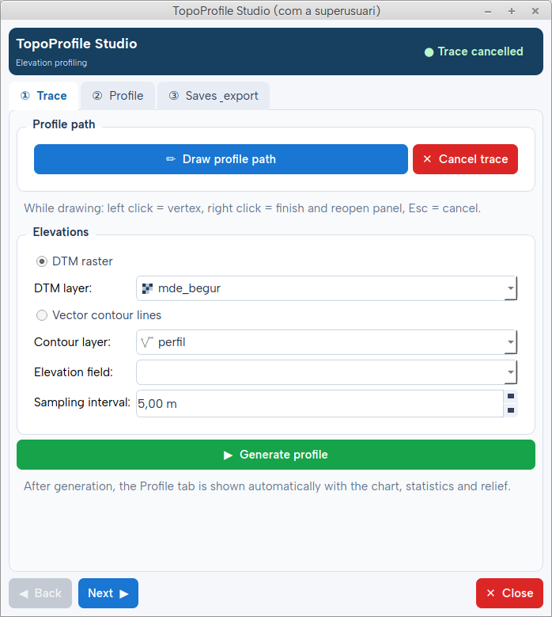
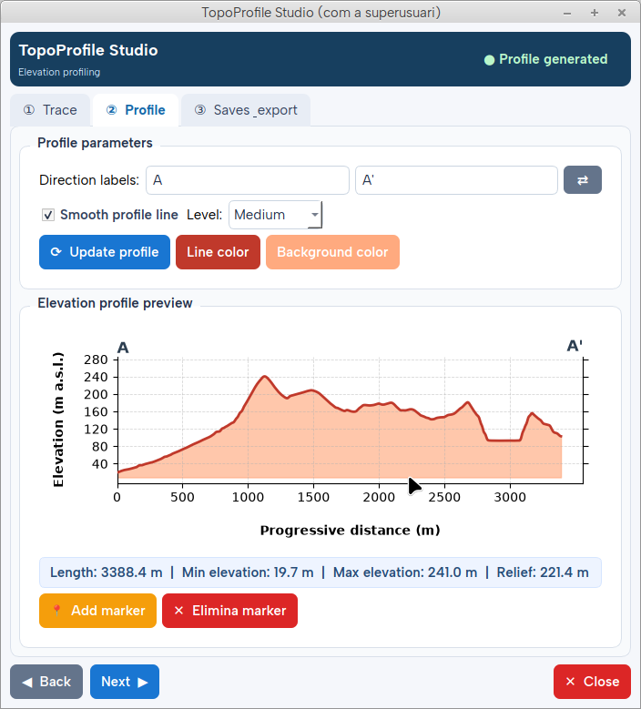
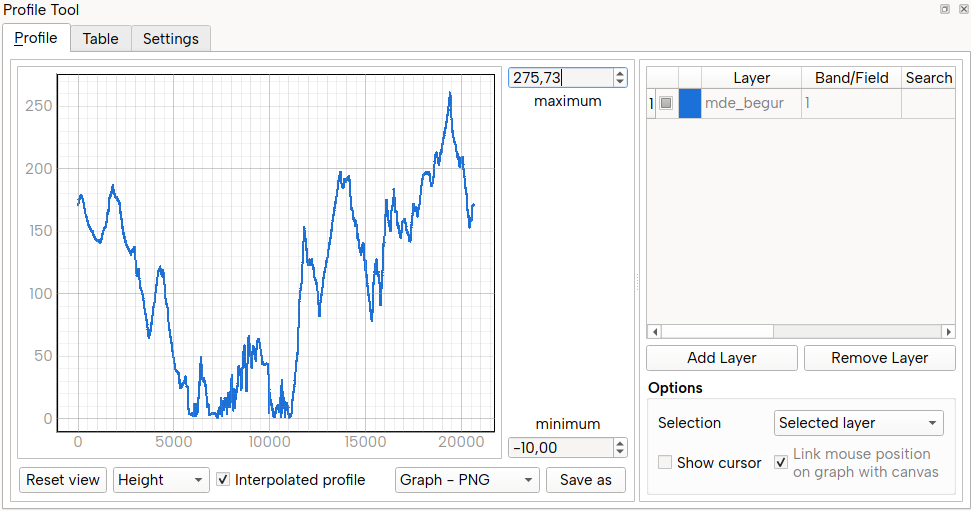
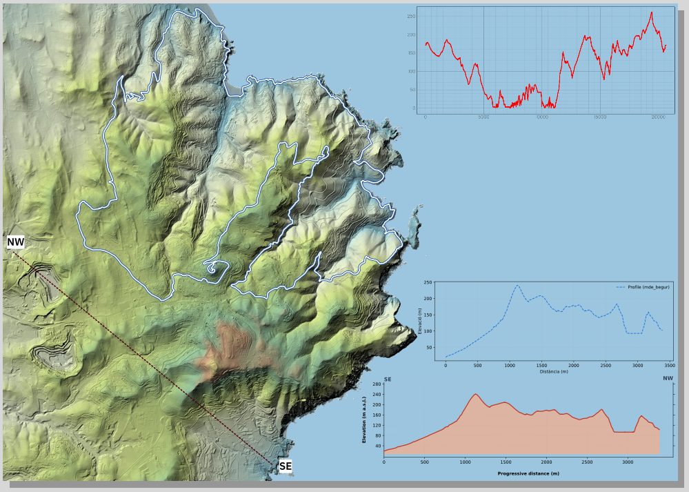

# La creació de perfils topogràfics amb QGIS

A l'hora de dissenyar un perfil topogràfic amb QGIS, per posteriorment incorporar-lo a un *layout* o disseny de mapa, disposem de diverses opcions:

* Dissenyar un perfil topogràfic a la finestra de mapa de QGIS
* Dissenyar el perfil topogràfic, directament des de la finestra de *layout*. 

## 1. Utilitzar complements o *plugins* de QGIS

Són diversos els complements (ArcGeek Calculator, Dual Profile Viewer, Terrain profile, ...) que, una vegada instal·lats a QGIS, permeten la creació i exportació un perfil topogràfic, en format d'imatge. La utilització d'un o altre complement dependrà en bona mesura del tipus de perfil que es vulgui generar.

Per a l'obtenció d'un perfil rectilíni, QGIS disposa de diverses opcions que són realment útils com, per exemple **Dual Profile Viewer** i **Open Topoprofile Studio**.

### 1.1. Dual profile Viewer

Una vegada instal·lat el complement, s'hi pot accedir bé a través del menú *Raster > Dual Profile Viewer* o bé, a través de la icona visible a la zona de barres d'eines.

En accedir a l'eina, es mostra un panell amb diverses opcions que caldrà configurar segons la necessitat. A continuació, es mostra un flux de treball bàsic per obtenir un perfil.

*  A l'apartat *Settings*, cal indicar el model digital d'elevacions que prèviament s'haurà carregat al panell de capes de QGIS: **Primary DEM/DTM**
*  A *Samples* cal indicar el nombre de mostres o punts que se situaran al llarg de la línia de perfil, d'on s'obtindrà el valor de cota.
*  Fer un clic sobre l'apartat o botó *Single Line* i dibuixar sobre la finestra de mapa, el punt inicial o final de la línia que es vol utilitzar per calcular el perfil. Una vegada incorporada la línia de perfil, el complement indica que havent finalitzat aquesta tasca, cal fer un clic sobre el botó *Create Profiles*.

* En fer un clic sobre el botó *Create Profiles*, automàticament es mostrarà el perfil topogràfic, podent alternar entre la visualització en mode **web**, o bé en mode **gràfic**. Aquest darrer (desactivant el mode web) permet ajustar-ne alguns paràmetres relatius a les dimensions:

* Així com el textos, color i gruix del perfil topogràfic. Havent realitzat tots els ajustos necessaris, es pot exportar el perfil topogràfic en format imatge (p.e. **.png**) o en format vectorial (**.svg**).

* 

El complement Dual Profile Viewer, a més, disposa d'una opció interessant i és que permet construir un layout bàsic, tot incorporant les capes visibles al panell de capes així com el perfil que s'acaba de calcular. Per a executar aquesta opció, cal fer un clic sobre l'opció *Generate layout*, i automàticament es crearà un nou *layout*, accessible des del gestor de *layouts* i des del menú *Project*. Aquest layout bàsic, es pot editar a continuació, per ajustar-los als criteris de disseny necessaris. 

### 1.2. Open TopoProfile Studio

Un altre complement de QGIS, que ofereix l'opció de dissenyar perfils topogràfics, especialment, com en el cas anterior, si aquests no són especialment sinuosos, doncs cal dibuixar la línia de manera manual. Una vegada instal·lat el complement, en activar-lo bé a través de la icona situada a la zona de les barres d'eines, bé des del menú *Plugins > TopoProfile Studio*, es mostrarà en una finestra emergent.

A continuació, es mostra un flux de treball bàsic per obtenir un perfil.

* Fer un clic sobre el botó *Draw profile path* i dibuixar, sobre la finestra de mapa, la línia de la qual se'n vol obtenir el perfil topogràfic. A continuació, havent indicat a l'apartat Elevations > DTM raster el nom del model digital d'elevacions amb el qual s'està treballant, cal fer un clic sobre el botó **Generate profile**.

* Automàticament es genera un perfil topogràfic on bàsicament, es pot editar el color del perfil, i del farcit del gràfic. També, el valor de les etiquetes de direcció.

* Fent un clic sobre el botó *Next*, es passa al darrer pas del complement, des d'on es pot exportar (*Export profile*) el gràfic a imatge raster (**.png**) o bé a gràfic vectorial (**.svg**).

### 1.3. Terrain Profile

En el cas que es necessiti generar un perfil topogràfic que ressegueixi, per exemple, el traçat d'una carretera, camí o recorregut, i que per tant no és especialment rectilini, fet que implicaria dur a terme un procés de pseudo-digitalització si s'utilitzen els complements anteriors, QGIS disposa de **Terrain Profile**. A continuació, es mostra un flux de treball bàsic per obtenir un perfil. 

* En activar aquesta eina, apareixerà un nou panell en el qual caldrà indicar dins l'apartat *Add layer*, quina és la capa relativa al model digital d'elevacions. Per a fer-ho cal, activar la capa en qüestió al panell de capes, i fer clic sobre el botó *Add layer*.
* A continuació, cal activar al panell de capes de QGIS, la capa de línia que representa el traçat, la forma de la qual, se'n vol obtenir el perfil topogràfic. Una vegada activa la capa al panell, dins l'apartat *Options* del panell de l'eina, al paràmetre Selection caldrà modificar el valor que es mostra per defecte, per **Selected layer**. Automàticament es genera un perfil que es pot desar en format d'imatge (.png).

## 2. Incorporar els perfils obtibnguts amb els complements anteriors.

Sigui quin sigui el complement emprat i el format d'exportació del gràfic (.png vs .svg), el més recomanable en tots els casos és editar les imatges amb un programa d'edició a l'estil de GIMP o Inkscape per tal d'eliminar el *background* (color de fons) blanc dels gràfics. A continuació, havent creat un nou layout, tots aquests gràfics es poden incloure en forma de nova imatge (*Add picture*), indicant en cada cas si es tracta d'una imatge raster (.png) o vectorial (.svg). Per tal de mantenir la legibilitat del gràfic en redimensionar-lo, i ajustar-lo a la mida del mapa, és recomanable desar els gràfics dels complements en format vectorial (.svg).

